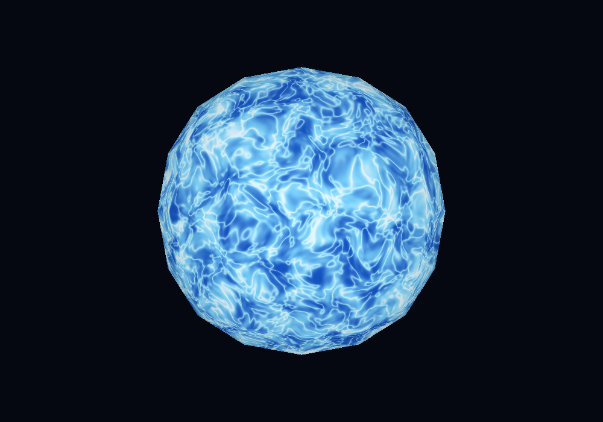
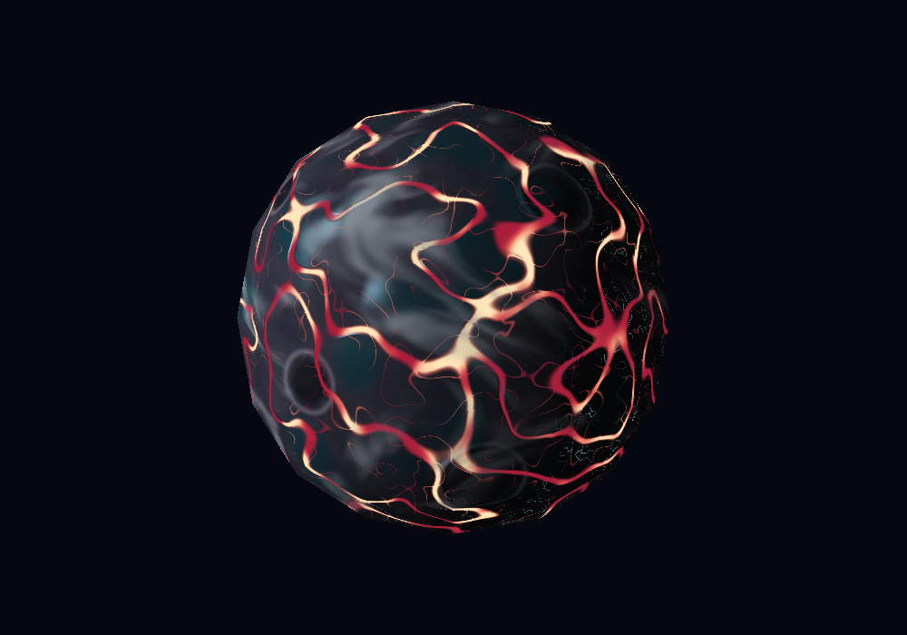
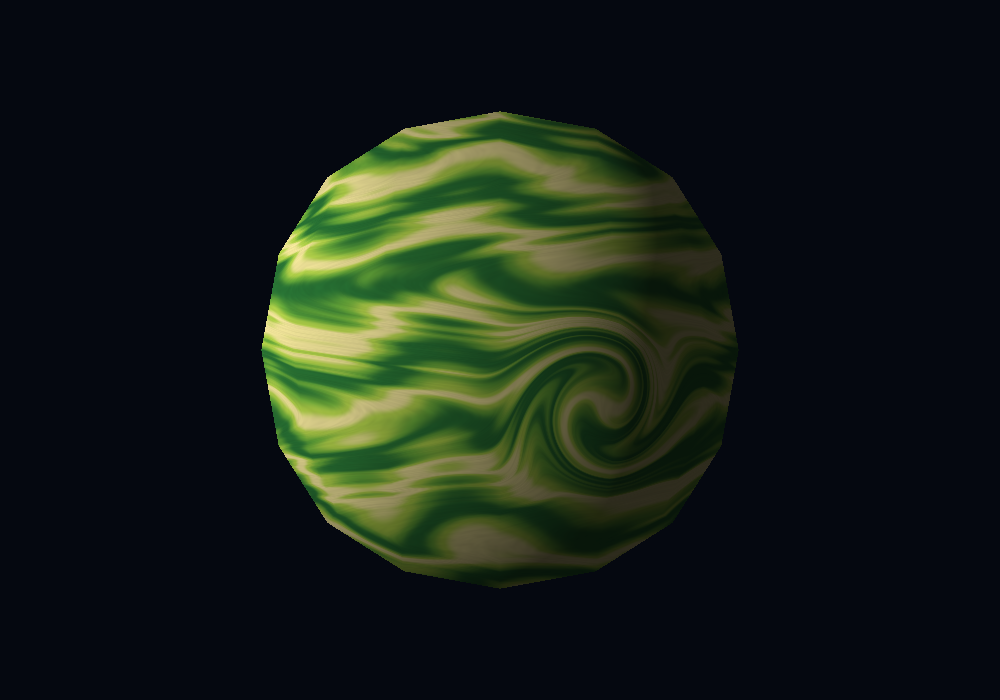

# Laboratorio 6: Planetas y estrellas con shaders

Tres cuerpos celestes generados mediante fragment shaders en CPU. Comparten la esfera proporcionada (`assets/sphere.obj`: 98 vértices y 192 triángulos), sin modificar sus vértices ni agregar geometría para los detalles.

## Compilación y ejecución

Requiere Rust/Cargo (verificado con Rust 1.99.1), CMake, compilador C/C++, Clang/libclang y las bibliotecas de desarrollo de OpenGL y X11: Xrandr, Xinerama, Xcursor y Xi en Linux. La ventana requiere una sesión gráfica; en Wayland utiliza XWayland. Cargo compila Raylib al instalar las dependencias.

```bash
git clone https://github.com/sallco/lab6-shaders.git
cd lab6-shaders
cargo build --release --locked
cargo run --release --locked
```

Se recomienda release para el sombreado en CPU. La ventana mide 1000×700; muestra el cuerpo seleccionado, el tiempo, la pausa y los FPS.

| Tecla | Acción |
| --- | --- |
| `1` / `2` / `3` | Seleccionar Cérula, Obsidia o Artaud; restablecer cámara y tiempo. |
| Flechas | Orbitar la cámara alrededor del cuerpo inmóvil. |
| `+` / `=` / `-` | Acercar/alejar; también admite el teclado numérico. |
| `Espacio` | Pausar/reanudar los patrones; la cámara sigue disponible. |
| `R` | Restaurar cámara y tiempo del cuerpo actual, conservando la pausa. |
| `Esc` | Salir. |

## Los tres cuerpos

### Cérula — estrella azul y blanca



Ruido OpenSimplex deformado combina células, filamentos calientes y manchas azul profundo. El ruido de cuatro dimensiones incorpora tiempo y cambia la actividad sin mover la geometría. Su color emisivo no depende de la luz externa. Destellos locales recorren los filamentos y un bloom calculado en CPU extiende un halo azul fuera de la superficie, conservando la geometría original.

En `src/shaders/star.rs`, `CELL_FREQUENCY` controla el tamaño de las células; `FILAMENT_CONTRAST`, la concentración de los filamentos; y `ACTIVITY_SPEED`, la velocidad de evolución. `star_shader` combina los patrones y sus colores. `EMISSION_GAIN` controla la luminosidad y `FLARE_STRENGTH`, los destellos. En `src/bloom.rs`, `BLOOM_STRENGTH` controla el halo y `BLOOM_RADIUS`, su extensión. Se aplica una máscara de brillo y desenfoque separable al framebuffer, sin otra esfera ni texturas externas.

La emisión y el halo hacen visible el brillo propio de Cérula. Al mostrar un solo cuerpo a la vez, la estrella no ilumina físicamente los planetas; estos utilizan la luz direccional fija del renderer.

### Obsidia — basalto, vidrio y lava coral



Ruido deformado define fracturas principales y ramificaciones de lava. Placas minerales, grano fino, ocho cráteres con bordes y depresiones, y cuencas de vidrio azul petróleo distinguen la corteza. El basalto es mate, el vidrio produce reflejos y la lava conserva emisión propia. Oleadas de calor recorren sus canales, alternando coral, rojo oscuro y núcleos amarillo pálido. Nubes de ceniza más contrastadas se desplazan con velocidades distintas por latitud sobre terreno fijo; filamentos turquesa aparecen en la noche. Un campo de altura modifica las normales para iluminar el relieve aparente.

En `src/shaders/rocky.rs`, `terrain` combina las regiones: `TERRAIN_FREQUENCY` aumenta el detalle de las fracturas y `LAVA_WIDTH` ensancha sus canales. `LAVA_FLOW_SPEED` controla la velocidad de los frentes térmicos sin mover las fracturas. `craters` contiene los centros y radios de los cráteres. Los parámetros de iluminación, nubes y relieve aparecen en la tabla de efectos.

### Artaud — gigante verde y amarillo



La paleta se inspira en la portada de *Artaud*, de Pescado Rabioso. Ondas que viajan por latitud, corrientes zonales de velocidad variable, ruido y deformación de coordenadas producen bandas fluidas en movimiento. Una rotación localizada del dominio curva las bandas alrededor de una tormenta que se retuerce periódicamente; su influencia disminuye gradualmente fuera del centro. Toda la animación ocurre en el material, sin rotar la geometría.

En `src/shaders/gas.rs`, `BAND_FREQUENCY` aumenta el número de bandas y `TURBULENCE` intensifica sus ondulaciones. `WIND_SPEED` controla las corrientes y `WAVE_SPEED`, las ondas. `gas_shader` combina las bandas y la iluminación; `vortex` realiza la distorsión temporal y `VORTEX_SPEED` controla su pulsación.

## Efectos para evaluación

Se solicitan los seis efectos siguientes: 55 puntos adicionales potenciales, junto a los 60 básicos, sujetos a evaluación y al máximo de 100. El movimiento de nubes no se cuenta como animación adicional de material; ese efecto corresponde a Cérula.

| Efecto | Cuerpo y archivo | Función y parámetro ajustable | Evidencia |
| --- | --- | --- | --- |
| Material animado — 5 | Cérula, `src/shaders/star.rs` | `star_shader`: `ACTIVITY_SPEED` cambia la velocidad del ruido temporal. | Captura de Cérula; GIF pendiente para observar la evolución. |
| Día/noche — 5 | Obsidia, `src/shaders/rocky.rs` | `night_emission`: la normal y la luz enmascaran minerales emisivos; `NIGHT_GLOW` controla su brillo nocturno. | GIF pendiente: orbitar hacia el hemisferio oscuro. |
| Respuestas distintas a la luz — 10 | Obsidia, `src/shaders/rocky.rs` | `glass_reflection`: reflejo dependiente de cámara y material; `GLASS_SPECULAR` controla intensidad y `GLASS_SHININESS`, concentración. | Captura de Obsidia; GIF pendiente para comprobar los reflejos al orbitar. |
| Nubes procedurales — 10 | Obsidia, `src/shaders/rocky.rs` | `cloud_mask`: mezcla una máscara sobre la superficie; subir `CLOUD_COVERAGE` reduce cobertura y `CLOUD_SPEED` aumenta velocidad. | Captura de Obsidia; GIF pendiente con cámara fija y tiempo activo. |
| Vórtice localizado — 10 | Artaud, `src/shaders/gas.rs` | `vortex`: distorsiona coordenadas antes de evaluar bandas; `VORTEX_RADIUS` controla extensión y `VORTEX_STRENGTH`, giro; `VORTEX_SPEED`, pulsación temporal. | Captura de Artaud; GIF pendiente para mostrar las corrientes y el vórtice cambiante. |
| Bump mapping — 15 | Obsidia, `src/shaders/rocky.rs` | `height` y `bump_normal`: diferencias finitas tangenciales perturban la normal; `BUMP_STRENGTH` controla relieve y `BUMP_STEP`, muestreo. | Captura de Obsidia; GIF pendiente para observar el relieve bajo luz fija. |

### Grabación pendiente

El GIF lo proporcionará el autor y se insertará aquí cuando esté disponible. La evidencia temporal y dependiente de luz queda pendiente de esa grabación.

Recorrido sugerido:

1. En Cérula, mantener la cámara fija unos segundos y pausar/reanudar para mostrar que cambia el material.
2. Seleccionar Obsidia y observar las nubes y las oleadas de lava sin mover la cámara: los cráteres y los canales conservan su ubicación.
3. Pausar Obsidia y orbitar hacia la derecha hasta ver la noche; acercarse para observar minerales, vidrio y relieve. La luz permanece fija en el mundo.
4. Seleccionar Artaud y dejar correr el tiempo con cámara fija para mostrar corrientes, ondas y vórtice. Acercarse después y usar `R` para recuperar el encuadre inicial.

## Renderer y verificación

Se reutilizan el cargador OBJ de `lab4-modelo` y la rasterización baricéntrica de `filling-triangles`. El pipeline calcula normales suaves, proyecta vértices, interpola atributos con corrección de perspectiva y resuelve profundidad. Después sombrea únicamente el fragmento visible final por píxel, repartido en regiones exclusivas entre hasta ocho hilos de CPU. Raylib presenta el framebuffer como textura y dibuja los textos de controles; no carga ni dibuja el modelo automáticamente.

Los patrones se evalúan en coordenadas locales mediante OpenSimplex con semilla 42 (`noise` 0.9). No se cargan imágenes como texturas ni materiales externos. Las normales cambian con el bump; los vértices y la silueta de la esfera original se conservan.

```bash
cargo test --locked
cargo clippy --locked --all-targets -- -D warnings
cargo fmt --check
cargo run --release --locked -- --export-captures
```

El último comando genera los tres PNG de `docs/` con cámara inicial y tiempo de 6 segundos; utiliza el mismo renderer y no requiere abrir una ventana. Reporta el tiempo de renderizado separado de la exportación. Las capturas no incluyen la interfaz de controles.

Verificado en Linux: 21 pruebas sobre OBJ, cámara, controles, interpolación, profundidad, reproducibilidad y efectos. También se comprueban colores finitos, geometría compartida, nubes independientes, emisión nocturna, reflejos, normales perturbadas y vórtice. Se comprueba además que las animaciones de ambos planetas cambian de forma perceptible en un segundo, manteniendo la profundidad idéntica. Las pruebas del bloom verifican luz fuera de la superficie sin alterar el búfer de profundidad. El rendimiento varía según equipo, cuerpo y zoom; la pausa permite explorar sin que avance el material.
